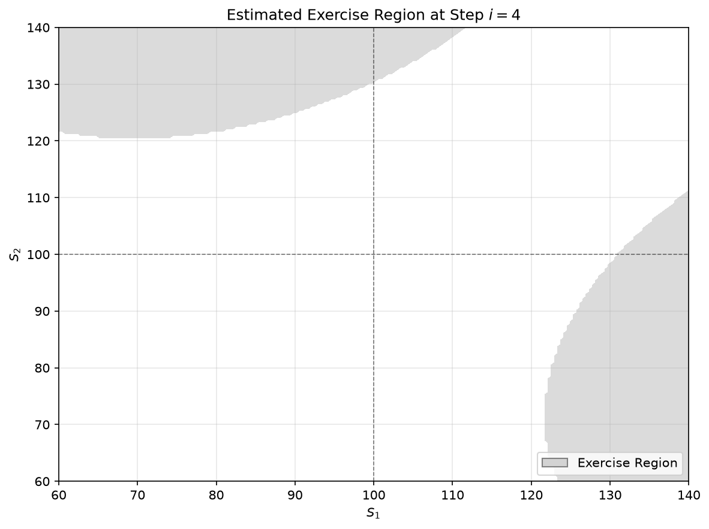

# Bermudan Max-Call Pricing with Regression-Based Monte Carlo

[](https://github.com/LGUETLE/Practical-Financial-Engineering/actions/workflows/tests.yml)

The project prices a Bermudan call on the maximum of two assets by Monte Carlo and replicates
Example 8.6.1 of Glasserman (2003). Four regression methods estimate the continuation value:
classic Longstaff–Schwartz (LSM), Tsitsiklis–Van Roy (TVR) and the two hybrids of their regression
target and regression sample. Each method learns an exercise policy that is priced out of sample,
which gives a low-biased estimate. An Andersen–Broadie duality bound adds an upper bound, turning
each estimate into a price interval. The European closed form (Stulz 1982) serves as a control
variate and, in scenarios calibrated to stock and crypto data, as an exact reference. Every number
comes with a standard error, methods are compared on common random numbers with paired tests and
Holm correction, and one script regenerates all results.

## Price intervals vs Glasserman

95% intervals [L − 1.96 SE_L, U + 1.96 SE_U] for TVR policies:
- **L:** out-of-sample lower bound on 200,000 paths.
- **U:** Andersen–Broadie upper bound with 4,000 outer × 2,000 inner paths.
- **Benchmark:** K = 100, T = 3, r = 0.05, δ = 0.10, σ = 0.2, ρ = 0, 9 exercise dates.

| S0 | Glasserman | 4,000 training paths: L / U | 95% interval | 100,000 training paths: L / U | 95% interval |
|---:|---:|---:|---|---:|---|
| 90 | 8.08 | 7.997 / 8.068 | [7.943, 8.123] | 8.011 / 8.055 | [7.957, 8.110] |
| 100 | 13.90 | 13.847 / 13.987 | [13.780, 14.056] | 13.874 / 13.955 | [13.806, 14.024] |
| 110 | 21.34 | 21.217 / 21.404 | [21.138, 21.486] | 21.253 / 21.370 | [21.174, 21.451] |

All six intervals contain the reference. Better policies have smaller duality gaps: 0.04–0.12 for
the policy trained on 100,000 paths, against 0.07–0.19 for the one trained on 4,000 paths.

## Key findings

Classic LSM and TVR differ in two factors: the regression target (realized cash flow vs value
iteration) and the regression sample (in-the-money paths vs all paths). A 2x2 design separates
them, and which factor matters depends on the regime.

- **Benchmark: the ITM filter drives the difference.**
  - TVR beats classic LSM by +0.018 (SE 0.0011; seed study, 4,000 replications), about 0.13% of
    the price: statistically clear, economically small.
  - In the 2x2 decomposition (R = 200, Holm-corrected), fitting on all paths instead of
    in-the-money paths only adds +0.023 (SE 0.0034, p = 1e-9). The target adds −0.0003
    (SE 0.0041, p = 0.94).
- **High volatility without dividends: the target matters.** Here the European Stulz price is
  exact.
  - At σ = 1.2 the bias is −2.14 for classic LSM and −0.70 for TVR (difference +1.44, SE 0.31).
  - Of this difference, value iteration contributes +1.15 (SE 0.30, Holm p = 0.018) and the
    all-paths sample +0.29 (SE 0.12, Holm p = 0.25, not significant). R = 20 replications;
    Holm over 21 tests.
- **No variance difference.** LSM and TVR estimates have statistically indistinguishable variances,
  both on the benchmark (Pitman–Morgan p = 0.47) and in a stress test with σ = 0.8 and as few as
  250 paths (all Holm p ≥ 0.91).

## Estimated exercise region

TVR policy at exercise date 4 of 9 (t = 4/3), trained on 20,000 paths. It exercises when one asset
is well above the strike and above the other, and continues near the diagonal (cf. Glasserman,
Fig. 8.9).



## How to run

```bash
python3 -m venv .venv
source .venv/bin/activate
pip install -r requirements.txt
python run_all.py        # regenerates everything in results/ (about 2 minutes on an Apple M4)
```

The individual scripts are listed in [docs/results.md](docs/results.md#reproducing-the-results).
`empirical_engine.py` downloads prices from Yahoo Finance on its first run and caches them in `data/`.

## Tests

```bash
pip install -r requirements-dev.txt
pytest                   # 47 tests, about 2 s
pytest -m "not slow"     # the 45 fast tests that GitHub Actions runs on every push
```

The tests check the simulation moments and correlations, the Stulz formula against Monte Carlo and
its limits, the basis, reproducibility, the control variate, the duality bound against a
brute-force martingale, and the benchmark price against 13.90.

## Background

Originally developed as a group project (three students) in the Project in Business Mathematics,
Institute of Financial Mathematics, University of Ulm, July 2026. I led the project and wrote the
code. Since then I have revised and extended it individually, adding:
- statistical testing and the four-method comparison;
- the closed-form benchmark, the control variate and the duality bounds;
- calibrated scenarios and tests.

## Documentation

- [docs/methods.md](docs/methods.md): model, the four regression methods, closed form, control
  variate, duality bound, calibration, statistics, code structure, references.
- [docs/results.md](docs/results.md): all results with full context (bounds, four-method comparison,
  LSM vs TVR seed study, basis ablation, control variate, calibrated scenarios, stress test).
- [docs/changelog.md](docs/changelog.md): changes since the course version.
- [results/](results/): generated tables and figures, regenerated by `run_all.py`.
