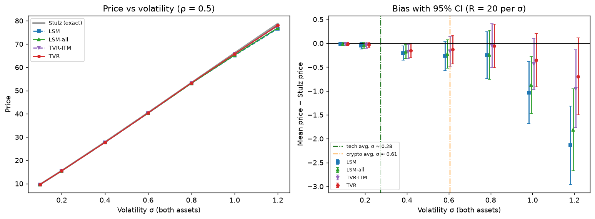
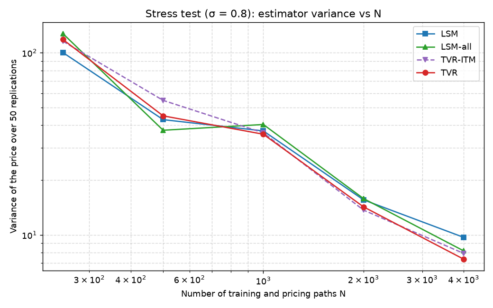
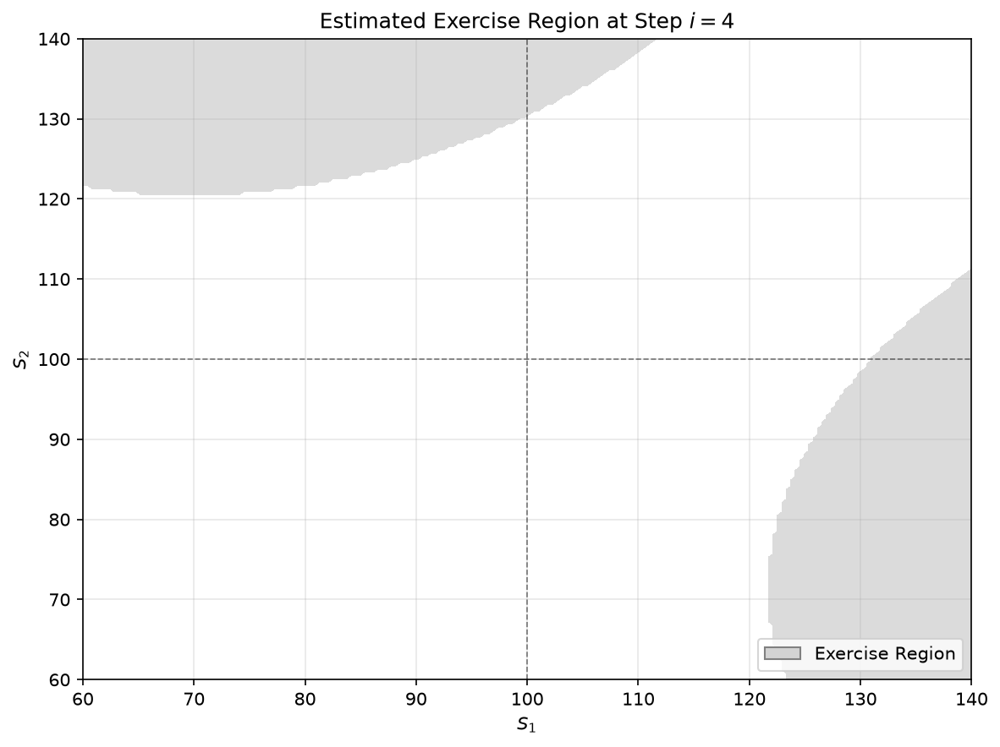

# Results

All results of the project with their full context. Methods are described in [methods.md](methods.md).

## Summary of findings

- **Price intervals.** The default policy gives 95% intervals of [7.94, 8.12], [13.78, 14.06]
  and [21.14, 21.49] for S0 = 90 / 100 / 110. All three contain the Glasserman reference values
  8.08 / 13.90 / 21.34. A policy trained on 100,000 paths narrows the duality gap to 0.04–0.12.
- **LSM vs TVR: which factor matters depends on the regime.** Classic LSM and TVR differ in both
  the regression target and the regression sample.
  - On the benchmark, TVR − LSM = +0.018 (SE 0.0011, seed study with 4,000 replications), about
    0.13% of the price: statistically clear, economically small. The 2x2 decomposition attributes
    it to the **regression sample**: all paths vs ITM paths +0.023 (SE 0.0034, R = 200). The target
    contributes −0.0003 (SE 0.0041).
  - With δ = 0 and high volatility the **target** matters instead. At σ = 1.2, TVR − LSM = +1.44
    (SE 0.31), of which value iteration contributes +1.15 (SE 0.30, Holm p = 0.018) and the sample
    +0.29 (SE 0.12, Holm p = 0.25).
- **No variance advantage for either method.** The variances of LSM and TVR are statistically
  indistinguishable, also at low path counts and σ = 0.8. The difference at high volatility is in
  the bias (policy quality), not the variance.
- **Basis.** Scaling the basis by the strike lowers the condition number by 3.5–5.4 orders of
  magnitude but changes no price. A complete degree-3 basis is *worse* than degree 2 at 4,000
  training paths.

## Detailed results

All numbers come from one run of `python run_all.py` (Python 3.13.2, numpy 2.5.5, scipy 1.18.1;
total runtime 124 s on an Apple M4, see [`results/run_info.md`](../results/run_info.md)). Full tables
are in [`results/`](../results/).

### Glasserman benchmark: price bounds

The lower bound L uses 200,000 independent paths. The upper bound U = L + gap uses 4,000 outer
paths and 2,000 inner paths per in-the-money date. All policies at one S0 share the same random
numbers. Full table, including classic LSM and a policy trained on 500 paths:
[`results/duality_bounds.md`](../results/duality_bounds.md).

| S0 | Policy | L (SE) | U (SE) | Gap (SE) | 95% interval | Reference |
|---:|---|---:|---:|---:|---|---:|
| 90 | TVR, 4,000 training paths (default) | 7.9972 (0.0278) | 8.0679 (0.0282) | 0.0707 (0.0047) | [7.9427, 8.1232] | 8.08 |
| 90 | TVR, 100,000 training paths | 8.0111 (0.0276) | 8.0552 (0.0278) | 0.0441 (0.0034) | [7.9571, 8.1097] | 8.08 |
| 100 | TVR, 4,000 training paths (default) | 13.8472 (0.0342) | 13.9869 (0.0354) | 0.1397 (0.0089) | [13.7801, 14.0563] | 13.90 |
| 100 | TVR, 100,000 training paths | 13.8743 (0.0350) | 13.9549 (0.0355) | 0.0806 (0.0058) | [13.8056, 14.0245] | 13.90 |
| 110 | TVR, 4,000 training paths (default) | 21.2174 (0.0405) | 21.4043 (0.0415) | 0.1868 (0.0090) | [21.1381, 21.4855] | 21.34 |
| 110 | TVR, 100,000 training paths | 21.2530 (0.0406) | 21.3704 (0.0411) | 0.1174 (0.0067) | [21.1735, 21.4510] | 21.34 |

- **The reference lies inside the 95% interval in all 12 cases** (four policies x three S0).
- **A better policy gives a smaller gap.** Ranked by lower bound, the four policies have strictly
  increasing gaps at every S0. At S0 = 100: 0.081 (TVR, 100,000 paths) < 0.140 (TVR, 4,000)
  < 0.161 (classic LSM, 4,000) < 0.442 (TVR, 500).
- **The gap separates policies more sharply than L.** At S0 = 110 classic LSM and TVR have
  indistinguishable lower bounds (difference −0.0095, SE 0.0118). The LSM gap is nevertheless
  larger by 0.025 (SE 0.008, Holm-adjusted p = 0.002).

### Four regression methods (2x2 design)

R = 50 replications per S0, N = 4,000 training and 4,000 pricing paths; all methods use the same
paths. Shown: mean (SE over replications). Full tables:
[`results/benchmark_2x2.md`](../results/benchmark_2x2.md).

| S0 | Reference | Classic LSM | Cash flow, all | Value, ITM | TVR |
|---:|---:|---:|---:|---:|---:|
| 90 | 8.08 | 8.0059 (0.0285) | 8.0242 (0.0274) | 8.0148 (0.0272) | 8.0201 (0.0289) |
| 100 | 13.90 | 13.8442 (0.0322) | 13.8729 (0.0321) | 13.8619 (0.0324) | 13.8684 (0.0331) |
| 110 | 21.34 | 21.2448 (0.0381) | 21.2542 (0.0381) | 21.2449 (0.0349) | 21.2464 (0.0374) |

All twelve means lie below the reference, as expected for low-biased estimators; biases range from
−0.03 to −0.10. (Cash flow, all paths) has the highest mean at every S0. After a Holm correction
over the nine comparisons with it, only classic LSM at S0 = 100 is significantly worse (−0.029,
adjusted p = 0.006).

To identify the driving factor, a confirmation run was made at S0 = 100: R = 200, an independent
seed, and four paired tests fixed before the run, with Holm correction.

| Contrast | Estimate | SE | Holm p |
|---|---:|---:|---:|
| TVR − classic LSM | +0.0226 | 0.0052 | 6.7e-05 |
| Target (value − cash flow) | −0.0003 | 0.0041 | 0.94 |
| Sample (all − ITM) | +0.0229 | 0.0034 | 1.1e-09 |
| Interaction | +0.0049 | 0.0052 | 0.69 |

On this benchmark **the regression sample, not the target, drives the LSM/TVR difference.**
- Fitting on all paths instead of ITM paths only gives a better policy (+0.023).
- Value-iteration targets instead of realized cash flows make no detectable difference.
- TVR − LSM is the sum of the two main effects, so it is almost entirely the sample effect.
- The effect is small. The most precise estimate of TVR − LSM, from the seed study below (4,000
  replications), is +0.0182 (SE 0.0011), about 0.13% of the price: statistically clear,
  economically small.

### Classic LSM vs TVR: variances

On the 50 replications at S0 = 100 ([`results/lsm_vs_tvr.md`](../results/lsm_vs_tvr.md)), the
variances are 0.0517 (LSM) and 0.0549 (TVR). Neither the F-test (p = 0.83) nor the Pitman–Morgan
test for paired samples (p = 0.47) rejects equal variances. The two price series are strongly
correlated across replications (0.96), as both use the same paths; the F-test ignores this, the
Pitman–Morgan test accounts for it. The paired mean difference TVR − LSM is +0.0243 (SE 0.0094,
p = 0.013), consistent with the R = 200 run above.

### Seed study: stage 1 vs rerun

Stage 1 (commit 49747bd) reported TVR − LSM = +0.0294 (SE 0.0082, p = 0.0008) at S0 = 100 from
one run of R = 50 replications with the legacy global seed `np.random.seed(2026)`. Rerunning it
with `np.random.default_rng(2026)` gave −0.0039 (SE 0.0097, p = 0.69).

**What differed between the two runs.**
- Unchanged: S0 = 100, N = 4,000 training and pricing paths, R = 50, degree-2 basis, and the seed
  value 2026. The paths were drawn in the same order (training 1, training 2, pricing 1, pricing 2
  per replication, one generator for all replications). The LSM and TVR code was unchanged.
- Changed: only the generator (legacy MT19937 `RandomState` vs PCG64 `Generator`, which also use
  different normal samplers), and hence every simulated path.
- Later changes (S/K scaling, the 2x2 refactor, the forward pass computing continuation values only
  in the money, exp(−r·dt·i) discounting) do not change prices. Verified against a git worktree of
  commit 49747bd:
  - The current code fed `np.random.RandomState(2026)` reproduces the stage-1 prices to 1.8e-15
    and the result +0.0294, p = 0.0008.
  - On identical paths the stage-1 and current code differ by at most 1.8e-15.

**Seed study.** The same experiment was repeated for seeds 1–40 with both generators
([`results/seed_study.md`](../results/seed_study.md), `seed_study.py`):

| Generator | Mean of 40 run means | SD across runs | Min | Max | Runs with p < 0.05 | Pooled (SE) |
|---|---:|---:|---:|---:|---:|---:|
| legacy MT19937 | +0.0191 | 0.0104 | −0.0031 | +0.0438 | 18 / 40 | +0.0191 (0.0015) |
| PCG64 | +0.0172 | 0.0091 | −0.0032 | +0.0322 | 16 / 40 | +0.0172 (0.0016) |

**Conclusion: Monte Carlo noise, not a code or configuration change.**
- The generators give the same distribution (Welch p = 0.37). Pooled over 4,000 replications,
  TVR − LSM = +0.0182 (SE 0.0011), and a single 50-run estimate has an SD of 0.0097.
- Stage 1 (+0.0294) lies 1.2 SD above the mean; 15% of the study runs are at least as high.
- The rerun (−0.0039) lies 2.3 SD below; none of the 80 study runs was that low.
- TVR is slightly better than LSM, as stage 1 concluded. But the effect (about 0.02, 0.13% of the
  price) is detected at the 5% level by only 34 of 80 single 50-run experiments, so a single such
  run is underpowered. The 2x2 confirmation run (R = 200, +0.0226) and the seed study agree.

### Basis ablation

S0 = 100, R = 50, all eight configurations on the same paths
([`results/basis_ablation.md`](../results/basis_ablation.md)).

| Method | Basis | Mean (SE) | Bias | median log10 condition number, raw → S/K |
|---|---|---:|---:|---|
| Classic LSM | degree 2 | 13.8117 (0.0337) | −0.088 | 6.0 → 2.3 |
| Classic LSM | degree 3 | 13.7831 (0.0319) | −0.117 | 8.7 → 3.3 |
| TVR | degree 2 | 13.8340 (0.0311) | −0.066 | 5.6 → 2.1 |
| TVR | degree 3 | 13.8218 (0.0305) | −0.078 | 8.3 → 3.0 |

- **Scaling** lowers the median condition number by 3.5–5.4 orders of magnitude but gives
  bit-identical prices on all 50 runs. In double precision the raw basis is not ill-conditioned
  enough to change a single exercise decision.
- **Degree 3** gives a lower mean than degree 2: paired difference −0.0286 for LSM (Holm p = 0.011)
  and −0.0123 for TVR (p = 0.14). With 4,000 training paths the four extra coefficients add more
  estimation noise to the policy than they remove approximation error.
- **Default.** Both estimators are low-biased, so degree 2 (scaled) is the default.

### European closed form and control variate

**Closed form.** The Stulz price agrees with a direct Monte Carlo price (N = 2,000,000) within 1.45
standard errors on all seven parameter sets
([`results/stulz_check.md`](../results/stulz_check.md)). The sets cover ρ ∈ {0, ±0.5, 0.3, 0.8, 0.9,
−0.9} and unequal volatilities, spot prices and dividend yields.

**Control variate.** Applied to the TVR policy on the same 50 replications as above
([`results/control_variate.md`](../results/control_variate.md)):

| S0 | European (Stulz) | Mean plain (SE) | Mean with CV (SE) | Corr(Y, X) | VRF per run | Variance ratio across runs |
|---:|---:|---:|---:|---:|---:|---:|
| 90 | 6.6551 | 8.0201 (0.0289) | 8.0186 (0.0217) | 0.69 | 1.92 | 1.78 |
| 100 | 11.1957 | 13.8684 (0.0331) | 13.8650 (0.0266) | 0.65 | 1.71 | 1.56 |
| 110 | 16.9286 | 21.2464 (0.0374) | 21.2390 (0.0307) | 0.60 | 1.56 | 1.49 |

- **The variance reduction is modest** (factor 1.5–1.9). With δ = 0.10 early exercise is worth a
  lot (13.90 vs 11.20 at S0 = 100), so the Bermudan and European payoffs are only moderately
  correlated.
- **Most of the variance across replications is pricing noise.** The reduction across runs, which
  also contains the training noise of the policy, is almost as large as the per-run factor.

### Calibrated scenarios: bias against an exact reference

**Setup.**
- Data: daily adjusted closes from Yahoo Finance, 2022-01-01 to 2025-12-31, for both pairs;
  annualised with 252 periods per year for stocks and 365 for crypto.
- Contract: S0 = 100 for both assets (normalised), K = 100, T = 1, r = 0.05, 12 exercise dates,
  δ = 0.
- Since δ = 0, the Stulz price is the exact Bermudan price.
- Each method: R = 50 replications with N = 10,000 paths, all methods on the same paths.
- Full tables: [`results/empirical.md`](../results/empirical.md).

Bias = mean − Stulz, with the SE over replications in brackets:

| Scenario | σ_1 / σ_2 / ρ | Stulz | Classic LSM | Cash flow, all | Value, ITM | TVR |
|---|---|---:|---:|---:|---:|---:|
| AAPL / MSFT | 0.284 / 0.267 / 0.626 | 19.2203 | −0.052 (0.040) | −0.036 (0.039) | −0.039 (0.040) | −0.032 (0.039) |
| BTC / ETH | 0.515 / 0.698 / 0.838 | 35.3960 | −0.310 (0.106) | −0.235 (0.106) | −0.192 (0.106) | −0.162 (0.106) |

- **All means lie below the exact price.** The RMSE over replications is 0.28 (tech) and 0.76–0.80
  (crypto).
- **Only classic LSM in the crypto scenario is significantly biased** after a Holm correction over
  the eight tests (p = 0.04).
- **The policies stop 6–10% of the pricing paths early**, although stopping early is never optimal
  here. Most of these paths are deep in the money, where the loss from stopping early is small.

**Volatility sweep.** A sweep over a common volatility (σ_1 = σ_2 = σ, ρ = 0.5, R = 20 per σ)
shows the bias growing with σ and the methods separating at high σ:
- At σ = 1.2 the bias is −2.14 for classic LSM and −0.70 for TVR (paired difference +1.44,
  SE 0.31, Holm p = 0.003).
- Classic LSM and TVR differ in both factors, so this difference is not due to value iteration
  alone. The 2x2 decomposition at σ = 1.2 (R = 20, paired over replications, Holm correction over
  all 21 contrasts of the sweep) splits it into:

  | Contrast at σ = 1.2 | Estimate | SE | Holm p |
  |---|---:|---:|---:|
  | TVR − classic LSM | +1.4394 | 0.3066 | 0.0033 |
  | Target (value − cash flow) | +1.1506 | 0.2993 | 0.0175 |
  | Sample (all − ITM) | +0.2888 | 0.1160 | 0.2473 |

- Unlike on the Glasserman benchmark, here the **regression target** matters. Value iteration
  instead of realized cash flows improves the price by 0.09 at σ = 0.6 (Holm p = 0.005) and by 1.15
  at σ = 1.2 (Holm p = 0.018).
- The sample effect is not significant at any σ after the correction. **Regime dependence:** on
  the benchmark (δ = 0.10, σ = 0.2) the ITM filter drives the LSM/TVR difference and the target
  does not matter. At high volatility without dividends the target matters, and the sample effect
  is not significant.
- A plausible explanation: with very noisy payoffs, the realized cash-flow targets give noisy fits
  in the money and hence more spurious early exercise. Note that the significant target effect
  appears only at σ ≥ 0.6. At the calibrated volatilities the methods differ by less than their
  standard errors.



### Stress test: low path counts at σ = 0.8

Glasserman parameters with σ = 0.8, N ∈ {250, …, 4,000} training and pricing paths, R = 50
replications per N, all methods on the same paths. Classic LSM is also run with the raw (unscaled)
basis. Full table: [`results/stresstest.md`](../results/stresstest.md).

| N | Classic LSM mean (variance) | TVR mean (variance) | Var LSM / Var TVR | Holm p (variance) | TVR − LSM (SE) |
|---:|---:|---:|---:|---:|---:|
| 250 | 65.59 (100.2) | 71.33 (118.2) | 0.85 | 1.00 | +5.74 (1.16) |
| 500 | 67.06 (42.9) | 70.74 (45.0) | 0.95 | 1.00 | +3.68 (0.77) |
| 1,000 | 68.36 (37.2) | 71.42 (35.7) | 1.04 | 1.00 | +3.06 (0.46) |
| 2,000 | 69.26 (15.6) | 71.57 (14.3) | 1.09 | 1.00 | +2.32 (0.40) |
| 4,000 | 69.95 (9.7) | 71.61 (7.4) | 1.32 | 0.91 | +1.67 (0.32) |

- **No LSM variance blow-up.** The original stress test was written to show one, using single
  unseeded runs with R = 30. With seeds, R = 50 and paired tests, the variances of LSM and TVR are
  statistically indistinguishable at every N (Pitman–Morgan test, Holm-corrected). Both fall
  roughly like 1/N.
- **Scaling does not matter here either.** Raw and scaled LSM give identical prices at every N,
  although the raw condition numbers reach 10^8.
- **What differs is the bias.** LSM's mean is lower by 1.7–5.7 (all Holm p < 1e-4), so its policy
  is clearly worse at high volatility and small N.
- **The basis is weak at this volatility.** The duality interval of a TVR policy trained on 100,000
  paths is [71.97, 75.51] (L = 72.61, U = 74.84). Its gap of 2.2 (3% of the price) shows that the
  degree-2 basis approximates the continuation value much less well at σ = 0.8 than at σ = 0.2.



### Estimated exercise region

The estimated exercise region at exercise date i = 4 (t = 4/3) comes from a TVR policy trained on
20,000 paths. The policy exercises when one asset is well above the strike and clearly above the
other, and continues near the diagonal S_1 = S_2, as in Glasserman's Figure 8.9.



Single runs (one training and one pricing set) for S0, σ and N are in
[`results/glasserman_replication.md`](../results/glasserman_replication.md) and
[`results/single_runs.md`](../results/single_runs.md). Their deviations from the reference, up to
1.3 standard errors, are Monte Carlo noise.

### Limitations

- The reference values 8.08 / 13.90 / 21.34 are quoted to two decimals; biases of a few hundredths
  are therefore only resolved through the duality interval, not against the reference alone.
- The bounds and their paired comparisons are conditional on one trained policy per S0. The 2x2
  replications include the training noise; the bounds do not.
- The calibrated scenarios use a constant-volatility GBM. They test the estimators at realistic
  volatility and correlation levels; they are not a market price of any traded product.

## Reproducing the results

```bash
python3 -m venv .venv
source .venv/bin/activate
pip install -r requirements.txt
python run_all.py              # regenerates results/ (about 2 minutes on an Apple M4)
```

`run_all.py` runs the five experiment scripts in order and writes the runtimes to
`results/run_info.md`. The scripts can also be run on their own (from the repository root):

| Script | Content | Runtime |
|---|---|---:|
| `theory_engine.py` | basis ablation, 2x2 design, LSM vs TVR, Stulz check, control variate, single runs, exercise region | 7 s |
| `bounds_engine.py` | lower and upper bounds by duality | 72 s |
| `empirical_engine.py` | calibration, bias against the Stulz price, volatility sweep | 9 s |
| `stresstest_engine.py` | low path counts at σ = 0.8 | 8 s |
| `seed_study.py` | stage-1 LSM vs TVR comparison over 40 seeds and two generators | 27 s |

`empirical_engine.py` downloads prices from Yahoo Finance on the first run (network access needed)
and caches them in `data/`. LaTeX/CSV tables go to `output_tables/` and additional plots to
`output_plots/`; both are not committed.

