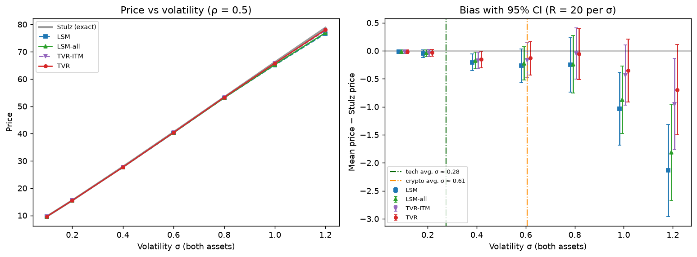

# Calibrated scenarios: bias against the exact European price

Daily adjusted closes from Yahoo Finance, identical window for both asset classes. Only volatilities and correlation are calibrated (log-returns, annualised with 252 trading days for stocks and 365 days for crypto); pricing uses the risk-neutral drift r. Contract: S0 = 100 for both assets (normalised), K = 100, T = 1, r = 0.05, 12 exercise dates, dividend yield 0. Without dividends early exercise of a max-call is never optimal, so the Bermudan price equals the European price (Stulz closed form), an exact reference. Generated by `empirical_engine.py`.

| Scenario | Assets | Window | Daily returns | Periods/year | sigma_1 | sigma_2 | rho |
|---|---|---|---:|---:|---:|---:|---:|
| tech | AAPL / MSFT | 2022-01-03 to 2025-12-31 | 1002 | 252 | 0.2841 | 0.2673 | 0.6265 |
| crypto | BTC-USD / ETH-USD | 2022-01-01 to 2025-12-31 | 1460 | 365 | 0.5153 | 0.6979 | 0.8380 |

R = 50 replications, N = 10,000 training and 10,000 independent pricing paths, all four methods on the same paths (seed 2026). Bias = mean - Stulz; p-value of H0: bias = 0 (t-test over replications) with Holm correction over all 8 tests. Early exercise share = fraction of pricing paths that the learned policy stops before maturity (optimal: 0).

| Scenario | Method | Mean | SE | Stulz | Bias | Bias / SE | p (bias = 0) | RMSE | Early exercise share | p (Holm) |
|---|---|---:|---:|---:|---:|---:|---:|---:|---:|---:|
| tech | Classic LSM (cash flow, ITM) | 19.1680 | 0.0395 | 19.2203 | -0.0523 | -1.32 | 0.1921 | 0.2817 | 0.0776 | 0.7684 |
| tech | Cash flow, all paths | 19.1845 | 0.0391 | 19.2203 | -0.0358 | -0.92 | 0.3642 | 0.2759 | 0.0654 | 0.9776 |
| tech | Value iteration, ITM | 19.1810 | 0.0396 | 19.2203 | -0.0393 | -0.99 | 0.3259 | 0.2797 | 0.0727 | 0.9776 |
| tech | TVR (value iteration, all) | 19.1881 | 0.0392 | 19.2203 | -0.0322 | -0.82 | 0.4151 | 0.2762 | 0.0625 | 0.9776 |
| crypto | Classic LSM (cash flow, ITM) | 35.0860 | 0.1056 | 35.3960 | -0.3101 | -2.94 | 0.0051 | 0.8017 | 0.1042 | 0.0405 |
| crypto | Cash flow, all paths | 35.1612 | 0.1065 | 35.3960 | -0.2349 | -2.21 | 0.0321 | 0.7814 | 0.0871 | 0.2248 |
| crypto | Value iteration, ITM | 35.2040 | 0.1062 | 35.3960 | -0.1921 | -1.81 | 0.0766 | 0.7677 | 0.0870 | 0.4598 |
| crypto | TVR (value iteration, all) | 35.2337 | 0.1062 | 35.3960 | -0.1624 | -1.53 | 0.1328 | 0.7611 | 0.0728 | 0.6639 |

Volatility sensitivity (sigma_1 = sigma_2 = sigma, rho = 0.5, R = 20 per sigma, N = 10,000): bias against the Stulz price.

| sigma | LSM | LSM-all | TVR-ITM | TVR |
|---:|---:|---:|---:|---:|
| 0.1 | -0.0172 | -0.0162 | -0.0172 | -0.0162 |
| 0.2 | -0.0510 | -0.0438 | -0.0383 | -0.0356 |
| 0.4 | -0.2080 | -0.1738 | -0.1730 | -0.1561 |
| 0.6 | -0.2654 | -0.2241 | -0.1698 | -0.1310 |
| 0.8 | -0.2470 | -0.2407 | -0.0462 | -0.0544 |
| 1.0 | -1.0331 | -0.8752 | -0.4334 | -0.3528 |
| 1.2 | -2.1354 | -1.8129 | -0.9510 | -0.6960 |

Standard errors of these biases (same layout):

| sigma | LSM | LSM-all | TVR-ITM | TVR |
|---:|---:|---:|---:|---:|
| 0.1 | 0.0171 | 0.0171 | 0.0171 | 0.0171 |
| 0.2 | 0.0336 | 0.0326 | 0.0317 | 0.0315 |
| 0.4 | 0.0759 | 0.0757 | 0.0763 | 0.0764 |
| 0.6 | 0.1538 | 0.1511 | 0.1584 | 0.1529 |
| 0.8 | 0.2504 | 0.2627 | 0.2331 | 0.2344 |
| 1.0 | 0.3316 | 0.3063 | 0.2744 | 0.2846 |
| 1.2 | 0.4197 | 0.4388 | 0.4146 | 0.4115 |

Paired contrasts per sigma (same paths for all methods; positive = higher, i.e. less biased, price). Holm correction over all 21 tests:

| sigma | Contrast | Estimate | SE | p | p (Holm) |
|---:|---|---:|---:|---:|---:|
| 0.1 | TVR - classic LSM | +0.0009 | 0.0007 | 0.1781 | 0.9737 |
| 0.1 | Target (value - cash flow) | -0.0000 | 0.0000 | 0.3299 | 0.9737 |
| 0.1 | Sample (all - ITM) | +0.0010 | 0.0007 | 0.1623 | 0.9737 |
| 0.2 | TVR - classic LSM | +0.0154 | 0.0052 | 0.0083 | 0.1167 |
| 0.2 | Target (value - cash flow) | +0.0105 | 0.0038 | 0.0123 | 0.1605 |
| 0.2 | Sample (all - ITM) | +0.0049 | 0.0034 | 0.1661 | 0.9737 |
| 0.4 | TVR - classic LSM | +0.0519 | 0.0128 | 0.0007 | 0.0121 |
| 0.4 | Target (value - cash flow) | +0.0264 | 0.0105 | 0.0208 | 0.2473 |
| 0.4 | Sample (all - ITM) | +0.0255 | 0.0102 | 0.0214 | 0.2473 |
| 0.6 | TVR - classic LSM | +0.1344 | 0.0311 | 0.0004 | 0.0069 |
| 0.6 | Target (value - cash flow) | +0.0943 | 0.0209 | 0.0002 | 0.0047 |
| 0.6 | Sample (all - ITM) | +0.0400 | 0.0219 | 0.0832 | 0.5822 |
| 0.8 | TVR - classic LSM | +0.1926 | 0.0825 | 0.0306 | 0.2473 |
| 0.8 | Target (value - cash flow) | +0.1935 | 0.0766 | 0.0206 | 0.2473 |
| 0.8 | Sample (all - ITM) | -0.0009 | 0.0360 | 0.9804 | 0.9804 |
| 1.0 | TVR - classic LSM | +0.6803 | 0.1736 | 0.0009 | 0.0157 |
| 1.0 | Target (value - cash flow) | +0.5610 | 0.1528 | 0.0016 | 0.0244 |
| 1.0 | Sample (all - ITM) | +0.1193 | 0.0899 | 0.2001 | 0.9737 |
| 1.2 | TVR - classic LSM | +1.4394 | 0.3066 | 0.0002 | 0.0033 |
| 1.2 | Target (value - cash flow) | +1.1506 | 0.2993 | 0.0011 | 0.0175 |
| 1.2 | Sample (all - ITM) | +0.2888 | 0.1160 | 0.0222 | 0.2473 |

