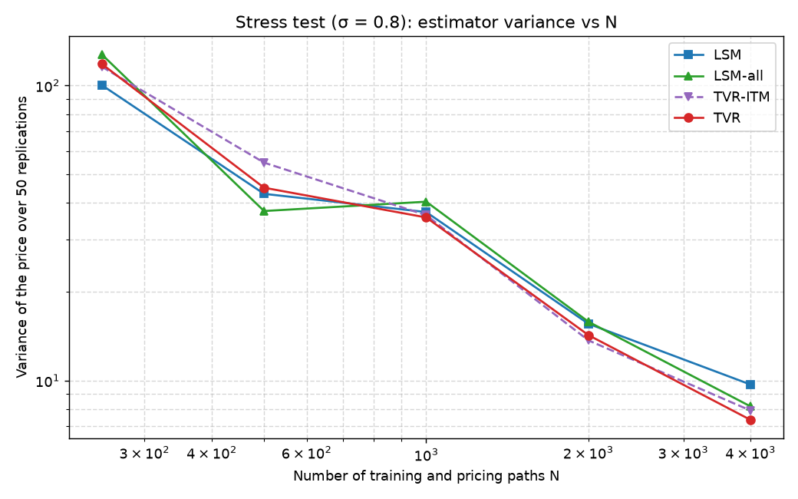

# Stress test: low path counts at sigma = 0.8

S0 = K = 100, T = 3, r = 0.05, delta = 0.10, sigma = 0.8, rho = 0, 9 exercise dates. For each N: R = 50 replications with N training and N independent pricing paths; all configurations use the same paths (seed 2026). Basis degree 2; 'raw basis' = classic LSM without scaling by K. Condition numbers over all dates and replications. Generated by `stresstest_engine.py`.

Reference interval for the true price (duality bounds of a TVR policy trained on 100,000 paths; 200,000 lower-bound paths, 4,000 x 2,000 nested paths): L = 72.606 (SE 0.326), U = 74.837 (SE 0.346), 95% interval [71.968, 75.515].

| N | Method | Mean | SE | Variance | log10 cond (median) | log10 cond (max) |
|---:|---|---:|---:|---:|---:|---:|
| 250 | LSM | 65.587 | 1.416 | 100.226 | 2.1 | 4.0 |
| 250 | LSM-all | 67.781 | 1.595 | 127.270 | 1.8 | 3.5 |
| 250 | TVR-ITM | 71.530 | 1.521 | 115.689 | 2.1 | 4.0 |
| 250 | TVR | 71.329 | 1.537 | 118.193 | 1.8 | 3.5 |
| 250 | LSM (raw basis) | 65.587 | 1.416 | 100.226 | 5.9 | 7.8 |
| 500 | LSM | 67.059 | 0.927 | 42.932 | 2.1 | 3.3 |
| 500 | LSM-all | 68.685 | 0.867 | 37.543 | 1.8 | 2.9 |
| 500 | TVR-ITM | 69.878 | 1.047 | 54.764 | 2.1 | 3.3 |
| 500 | TVR | 70.740 | 0.949 | 45.029 | 1.8 | 2.9 |
| 500 | LSM (raw basis) | 67.059 | 0.927 | 42.932 | 5.9 | 7.1 |
| 1000 | LSM | 68.359 | 0.863 | 37.232 | 2.1 | 4.2 |
| 1000 | LSM-all | 69.647 | 0.899 | 40.377 | 1.8 | 3.8 |
| 1000 | TVR-ITM | 70.841 | 0.852 | 36.337 | 2.1 | 4.2 |
| 1000 | TVR | 71.418 | 0.845 | 35.705 | 1.8 | 3.8 |
| 1000 | LSM (raw basis) | 68.359 | 0.863 | 37.232 | 6.0 | 8.1 |
| 2000 | LSM | 69.258 | 0.558 | 15.577 | 2.2 | 3.3 |
| 2000 | LSM-all | 70.738 | 0.563 | 15.830 | 1.9 | 3.0 |
| 2000 | TVR-ITM | 70.930 | 0.523 | 13.686 | 2.2 | 3.3 |
| 2000 | TVR | 71.574 | 0.534 | 14.259 | 1.9 | 3.0 |
| 2000 | LSM (raw basis) | 69.258 | 0.558 | 15.577 | 6.0 | 7.2 |
| 4000 | LSM | 69.947 | 0.440 | 9.695 | 2.2 | 3.7 |
| 4000 | LSM-all | 71.078 | 0.404 | 8.173 | 1.9 | 3.3 |
| 4000 | TVR-ITM | 70.782 | 0.398 | 7.915 | 2.2 | 3.7 |
| 4000 | TVR | 71.615 | 0.384 | 7.359 | 1.9 | 3.3 |
| 4000 | LSM (raw basis) | 69.947 | 0.440 | 9.695 | 6.0 | 7.5 |

Classic LSM vs TVR (scaled basis) per N, Holm correction over the five N values for each test, and the effect of scaling on classic LSM:

| N | Var LSM / Var TVR | Pitman-Morgan p | PM p (Holm) | Mean TVR - LSM | SE (diff) | Paired t p | t p (Holm) | max abs. LSM raw - scaled |
|---:|---:|---:|---:|---:|---:|---:|---:|---:|
| 250 | 0.848 | 0.4295 | 1.0000 | +5.742 | 1.156 | 8.7e-06 | 1.7e-05 | 0.00e+00 |
| 500 | 0.953 | 0.8258 | 1.0000 | +3.681 | 0.768 | 1.6e-05 | 1.7e-05 | 0.00e+00 |
| 1000 | 1.043 | 0.7828 | 1.0000 | +3.059 | 0.465 | 2.9e-08 | 1.5e-07 | 0.00e+00 |
| 2000 | 1.092 | 0.6571 | 1.0000 | +2.316 | 0.404 | 5.9e-07 | 2.4e-06 | 0.00e+00 |
| 4000 | 1.317 | 0.1817 | 0.9086 | +1.668 | 0.320 | 3.6e-06 | 1.1e-05 | 0.00e+00 |

